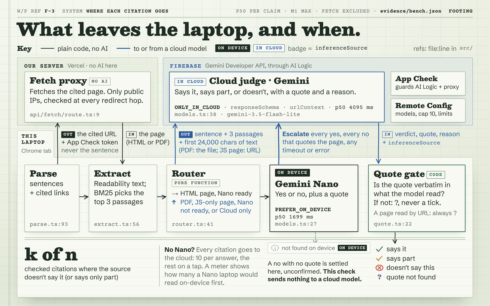

<div align="center">
  
  <h1>Footing ✓</h1>
  <p><em>Checks that each link cited in an AI answer actually says what the sentence claims.</em></p>
  

  <br/>

  [](https://footing.edycu.dev)
  [](https://youtu.be/1okeD78D7Nw)
  [](https://footing.edycu.dev/eval)
  [](https://firebasehybridaihackathon.devpost.com/)

  <br/>

  
  
  
  [](https://github.com/edycutjong/footing/releases)
  
  [](LICENSE)

</div>

---

Footing checks **citation faithfulness**, not truth: paste an AI answer with its source links, and every cited sentence gets a pencil mark
(vouched, partly vouched, or circled red) beside the exact line the source really contains.

## 📸 See it in Action

Open **https://footing.edycu.dev**, the sample answer is pre-filled (or press **Fill the sample**), then press **Check sources**. No login. Each chip shows which model decided it
(`ON DEVICE` or `IN CLOUD`, taken from the response's `inferenceSource`), and the evidence pane shows the quote the source contains.
A judge without Gemini Nano still gets the full check through the cloud (see [No Nano? Still works](#-no-nano-still-works)).

## 💡 The Problem & Solution

### The Problem
AI answers arrive with links that look like proof. The link may not say the sentence, or only part of it, and checking by hand means
opening every tab. In a 2023 human audit of four popular generative search engines, only 74.5% of citations supported their associated sentence
(Liu, Zhang and Liang, [arXiv:2304.09848](https://arxiv.org/abs/2304.09848); quoted in `evidence/problem/liu-2023-verifiability.md`).

### The Solution
Footing fetches each cited page, picks the three best-matching passages (BM25), and asks one question per (sentence, passage) pair.
**Gemini Nano on your laptop triages every readable cited page (PDFs and JavaScript-only pages go to the cloud) with a median under 2 seconds on our M1 Max and marks the ones with no supporting passage itself; every citation Nano thinks is supported goes to a cloud model for the final call.** Then plain code
checks that every quote the model relied on exists, word for word, in the text the model was given. A verdict whose quote is not found is
shown as `UNVERIFIED`, never as supported. The gate proves the quoted words are in the source; it does not prove the model read them
correctly (on the fresh 20, 6 wrong cloud verdicts still carried a quote that was found, by the eval's joined-text rule, `/eval`).

## 🏗️ Architecture & Tech Stack

<p align="center"></p>

| Layer | What | Where |
|---|---|---|
| UI | Next.js 16 (App Router) + TypeScript on Vercel | `src/app`, `src/components` |
| Inference | `firebase/ai` hybrid: Gemini Nano on device, Gemini in the cloud (Gemini Developer API, free tier) | `src/lib/ai/models.ts` |
| Fetch proxy | one route handler, **no inference**: SSRF guard (http/https, no private or link-local addresses, 5 MB HTML / 8 MB PDF cap, 8 s timeout, 3 redirects) | `src/app/api/fetch/route.ts`, `src/lib/net/ssrf.ts` |
| Extraction | Readability + BM25 passage pick, deterministic | `src/lib/extract.ts`, `src/lib/bm25.ts` |
| Router | pure function: page kind, device state, per-answer cloud cap | `src/lib/route/router.ts` |
| Quote gate | code, not a model | `src/lib/gate/quote.ts` |
| Config | Firebase Remote Config (model names, cap, thresholds), bounds-checked | `src/lib/remoteConfig.ts` |
| Abuse control | Firebase App Check (reCAPTCHA Enterprise), verified server-side on the proxy | `src/lib/firebase.ts`, `src/lib/net/appcheck.ts` |

## 🏆 Firebase AI Logic Integration

Every model call in the app goes through Firebase AI Logic (`getAI` with `GoogleAIBackend`, `src/lib/firebase.ts:43`); the proxy never
calls a model API.

| Mode | Used for | Real call |
|---|---|---|
| `InferenceMode.PREFER_ON_DEVICE` | Nano binary triage `SUPPORTS \| NOT_SUPPORTED` + quote, with `onDeviceParams.promptOptions.responseConstraint`; `inCloudParams` is the safety net if a Nano call falls back at runtime (badged `IN CLOUD`, still escalated, `router.ts:82`); when Nano is missing or downloading the router skips triage and sends the citation straight to the cloud judge (`router.ts:60-61`) | `src/lib/ai/models.ts:28-33` |
| `InferenceMode.ONLY_ON_DEVICE` | the "On-device only" switch, and the case where this answer's cloud cap is spent | `src/lib/ai/models.ts:29` |
| `InferenceMode.ONLY_IN_CLOUD` + `responseSchema` | the deciding judge, 3-class `SUPPORTS \| PARTIAL \| NOT_SUPPORTED`; also reads PDFs (PDF input is cloud-only) | `src/lib/ai/models.ts:39-41` |
| `ONLY_IN_CLOUD` + `tools: [{ urlContext: {} }]` | pages that need JavaScript (URL context is cloud-only) | `src/lib/ai/models.ts:46-51` |
| `model.generateContent(...)` | the runtime calls: Nano triage (`PREFER_ON_DEVICE` / `ONLY_ON_DEVICE`), cloud judge, PDF judge, URL-context judge | `src/lib/check/browserDeps.ts:82-83`, `:98-101` |
| `response.inferenceSource` | the badge on every chip; recorded for every call in the run trail | `src/lib/check/browserDeps.ts:62,89`, `src/lib/check/engine.ts:204` |
| `initializeAppCheck` + `ReCaptchaEnterpriseProvider` | App Check on, enforced for AI Logic | `src/lib/firebase.ts:39-40` |
| Remote Config `fetchAndActivate` | model names and the cloud cap, changeable without a deploy | `src/lib/remoteConfig.ts:44` |

### The routing rule, and why
The split is about **capability, not policy** (`src/lib/route/router.ts:41`):

- **Readable HTML and Nano available:** triage on the laptop (`PREFER_ON_DEVICE`).
- **PDF:** cloud only. PDF input is cloud-only in AI Logic.
- **Page that needs JavaScript** (fetched text under 400 characters): cloud with the URL context tool. Its verdict is shown as `UNVERIFIED`:
  there is no fetched text to check the quote against (`src/lib/gate/quote.ts:41`).
- **Nano missing, still downloading, or "Cloud only" chosen:** cloud.
- **Nano alone settles only one thing:** "no supporting passage found in the 3 it read" (`src/lib/route/router.ts:86-87`). Everything else
  escalates to the cloud (or, once this answer's cap is spent, waits for a click): every Nano `SUPPORTS` (the cloud decides full vs partial), a
  `NOT_SUPPORTED` that quotes related text, a quote not in what Nano read, a timeout or an unreadable reply (`router.ts:79-91`). Nano is never described as deciding "partly supported".

App Check: the debug provider is for localhost and the test harness only; its token is passed through the `FIREBASE_APPCHECK_DEBUG_TOKEN` env var and is never written to this repo,
and the production build ships the reCAPTCHA Enterprise provider.

## 📊 Engineering Rigor

All figures come from raw rows in [`evidence/`](evidence) and reproduce with one command:

```bash
npm ci && npm run eval      # recomputes every number below from the committed rows, no model calls; exits 1 on any mismatch
```

Machine for on-device runs: MacBook Pro M1 Max, 32 GB, Chrome 157. Cloud judge: `gemini-3.5-flash-lite`.

| Set | Nano binary triage | Cloud judge (3-class) |
|---|---|---|
| **Fresh 20, held-out** (labelled and committed before any run, `13d2240`) | **13/20 = 65%**; latency p50 1729 ms, p95 2335 ms | **14/20 = 70%**; latency p50 2284 ms, p95 6924 ms |
| Frozen 30 (**not** held-out: an earlier prompt was scored on it) | 24/30 = 80% (binary-only run, 22 Nov; the 21 Nov three-way run cut to binary also gave 24/30); p50 1838 ms, p95 3099 ms | 23/30 = 76.7% |

How the work splits between laptop and cloud: on the frozen 30, Nano settled 8 of 30 pairs on device (all 8 labelled partial or not supported) and escalated 22; on the
fresh 20 it settled 1 and escalated 19 (`evidence/summary.json`). So the measured cloud saving is small: 8 of 30 and 1 of 20 calls, and 1 of 9 on
the sample answer's recorded Nano run (`evidence/check/nano-hero-if-2026-11-22.json`). Escalation is the design, not a failure: `SUPPORTS` is never final on device.
An escalated citation pays for both calls, and Nano triage runs one citation at a time, so the hybrid is not faster end to end. Recorded runs of the sample answer on the
deployed site on 22 Nov: the one run in which Nano triaged on device took 36.0 s wall clock (`evidence/check/live-r03-nano-hero-2026-11-22-1300.json`); the 9 runs in
which every citation went to the cloud took 17.0–41.0 s (median 21.0 s: 7 fresh-profile runs, `evidence/check/live-*fresh-hero*.json`, plus 2 Nano-profile runs whose
model was not ready at the click, `live-r03-nano-hero-2026-11-22.json` and `-1258.json`); all but one ran at the earlier cap of 8 and left at least one citation for a
click (the 18.0 s run left 4, after rate-limit errors, before automatic retries existed). The one 9-of-9 run, at cap 10, took 21.0 s without Nano
(`evidence/check/live-r05-fresh-hero-2026-11-22.json`). What the laptop buys is that the citations it settles never reach a model server.

Tests: **194 passing** in 12 files (`npm test`), covering the router, quote gate, SSRF guard, App Check verification, parser,
extractor, tally and the check engine. Line coverage of `src/lib` is 88.6% (`npm run test:coverage`, receipt `evidence/coverage-2026-11-23.txt`; the Firebase-SDK glue files are excluded
and covered by the E2E run instead, see `vitest.config.ts`).

**Latency per claim** (`npm run bench`, raw rows in [`evidence/bench.json`](evidence/bench.json); 20 held-out claims × 2 reps per route, one untimed warm-up
each, M1 Max, Chrome 157, source fetching excluded): on device (Nano binary triage) **p50 1699 ms, p95 2067 ms**; in the cloud (`gemini-3.5-flash-lite`
judge reading a 24,000-character source window) **p50 4095 ms, p95 11476 ms**. All 80 calls returned the `inferenceSource` they were meant to. This is a separate run from the table above (a dev-server harness, so its numbers differ from the 1729 / 2284 ms in that table).

### 🧪 Testing & CI
**Status, stated plainly:** the pipeline below is committed and configured, but **GitHub Actions has not run it** (the account's Actions billing blocked every job on
2026-11-22, and the repo is private until submission), so there is no green CI badge here. Instead every stage was run on the maintainer's machine with
[`scripts/ci-local.sh`](scripts/ci-local.sh) against the commit deployed at the time (2026-11-22), all passing; the receipt is [`evidence/ci-local-2026-11-22.txt`](evidence/ci-local-2026-11-22.txt) (191 unit tests then; the 194 on the current commit are in [`evidence/vitest-2026-11-23.txt`](evidence/vitest-2026-11-23.txt)).
`v1.0.0` was tagged by hand for the same reason (`release.yml` has not executed yet).

[`.github/workflows/ci.yml`](.github/workflows/ci.yml) is configured to run seven stages on every push to `main`: quality (lint, typecheck, unit tests with a coverage floor
on Node 20 and 22) and security (gitleaks over the full history, `npm audit` failing on high or critical, registry signatures, licence check) in parallel; production build
with a gzip bundle budget (716 KB measured, budget 900 KB); deploy to Vercel (prebuilt); **Playwright E2E against the live URL**; Lighthouse gates on the live URL; and a
release gate. [`codeql.yml`](.github/workflows/codeql.yml) (security-extended queries) is set to run on push, PR and weekly once the repo is public (it needs GitHub Advanced
Security while private), [`release.yml`](.github/workflows/release.yml) tags a version from conventional commit messages, and Dependabot is grouped and monthly with majors ignored.

Measured on the deployed build (`evidence/lighthouse-live-2026-11-22.json`, desktop preset, 3 runs per page): performance 1.00, accessibility 1.00, SEO 1.00 and layout shift
0.003 on `/`; best practices 0.77 on `/` because reCAPTCHA Enterprise, which App Check needs, sets a third-party cookie (the gate is 0.75, `lighthouserc.json`), and 1.00 on `/eval`.

The E2E suite (`e2e/`, 12 tests, run against the live URL) drives the real, unmocked flow: it opens the hosted page, presses **Check sources** on the sample answer, and
asserts that chips land with an `IN CLOUD` route badge, every decided verdict carries a non-empty quote (the verbatim-in-source check itself is unit-tested in
`test/text-bm25-gate.test.ts`; a failed gate shows `UNVERIFIED`), and the evidence pane opens. `e2e/unplug.spec.ts` cuts the whole network after load, and separately blocks only
the AI Logic hosts while sources stay readable, and asserts both times that the check reports failure and never produces a verdict. `npm run e2e:nano` repeats the flow on a
Nano-enabled profile and asserts the `ON DEVICE` route really ran (`evidence/check/e2e-nano-2026-11-22.json`).

## 🔓 No Nano? Still works

A judge on a laptop without Gemini Nano still gets every check: each pair is checked in the cloud (up to 10 per answer automatically, the rest
on a click) and badged `IN CLOUD`, and a meter reads how many citations the same router rule would have read on-device first on a Nano laptop.
What that judge cannot see live is Nano itself; a recorded Nano run of the sample answer plays at [/about](https://footing.edycu.dev/about). On a Nano laptop, a **force path** control (Auto, On-device only, Cloud only) shows both routes. In a browser with no on-device model at all, On-device only reports "no on-device model in this browser" for each readable page (`router.ts`, `test/router.test.ts`); a Chrome whose model is not downloaded yet waits for the download instead. The recorded Auto run at /about shows the on-device path.

To turn Nano on in desktop Chrome: enable `chrome://flags/#gemma4-for-built-in-ai` (**Gemma 4 for Built-in AI**, the flag the hackathon FAQ names) and
`chrome://flags/#prompt-api`, relaunch, and make sure
the profile's disk has at least 22 GB free (the figure in Chrome's built-in AI documentation). The first on-device call starts a model download,
and the page shows its progress.

## 🚀 Getting Started

### Prerequisites
Node 22 (what we developed on), a Firebase web app with AI Logic enabled and an App Check provider. Put the web config in `.env.local` using the keys in `.env.example`.

### Installation
```bash
npm ci
npm run dev        # http://localhost:3101
npm test           # 194 tests
npm run ci         # audit + lint + typecheck + tests with coverage
npm run e2e        # Playwright against https://footing.edycu.dev (BASE_URL=http://localhost:3101 npm run e2e for local)
npm run bench      # per-claim p50/p95 on device and in the cloud (needs a Nano profile, see DEMO.md)
```

## 📁 Project Structure

```
src/lib/ai/        model construction, prompts, schemas
src/lib/route/     the router rule
src/lib/gate/      the quote gate
src/lib/net/       SSRF guard, App Check verification, source fetch
src/lib/check/     the check engine
src/app/           pages: /, /eval, /about, /api/fetch, /api/health
evidence/          raw rows behind every number
scripts/           npm run eval and the live harnesses
```

## 🧱 Pre-existing work and what is new

Everything in this repository was written during the submission window; its history starts on 2026-11-22. The kill test and the frozen-30 labels (2026-11-21, also inside the window) were made in
a scratch harness before the repo existed; their outputs are committed under `evidence/p0c/` and `evidence/eval-30/`. Third-party libraries: `firebase`, `next`,
`react`, `@mozilla/readability`, `linkedom`, `jose`, `ipaddr.js`, `unpdf` (see `package.json`). No code, HTML or assets copied from other entries.

## 📽️ Demo Materials

Demo video (2:48): https://youtu.be/1okeD78D7Nw · Live: https://footing.edycu.dev · Measured results: https://footing.edycu.dev/eval · Walkthrough with reproduce steps: [`DEMO.md`](DEMO.md) ·
Build notes: [`docs/DX-REPORT.md`](docs/DX-REPORT.md)

## 📄 License

Apache-2.0, see [`LICENSE`](LICENSE).
