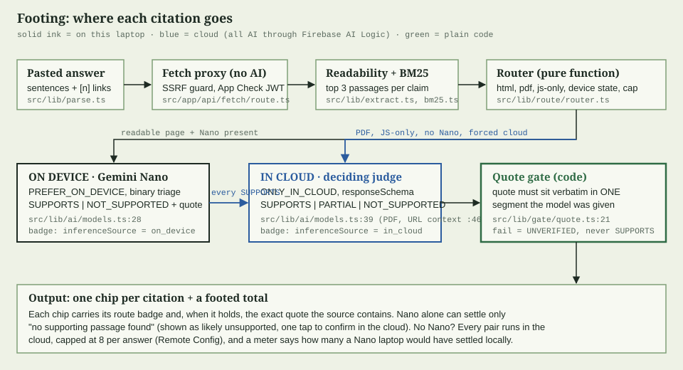

<div align="center">
  
  <h1>Footing ✓</h1>
  <p><em>Checks that each link cited in an AI answer actually says what the sentence claims.</em></p>
  

  <br/>

  [](https://footing.edycu.dev)
  [](https://footing.edycu.dev/eval)
  [](https://firebasehybridaihackathon.devpost.com/)

  <br/>

  
  
  
  [](https://github.com/edycutjong/footing/actions/workflows/ci.yml)
  [](https://github.com/edycutjong/footing/releases)
  
  [](LICENSE)

</div>

---

Footing checks **citation faithfulness**, not truth: paste an AI answer with its source links, and every cited sentence gets a pencil mark
(vouched, partly vouched, or circled red) beside the exact line the source really contains.

## 📸 See it in Action

Open **https://footing.edycu.dev**, the sample answer is pre-filled (or press **Fill the sample**), then press **Check sources**. No login. Each chip shows which model decided it
(`ON DEVICE` or `IN CLOUD`, taken from the response's `inferenceSource`), and the evidence pane shows the quote the source contains.
A judge without Gemini Nano still gets the full check through the cloud (see [No Nano? Still works](#-no-nano-still-works)).

## 💡 The Problem & Solution

### The Problem
AI answers arrive with links that look like proof. The link may not say the sentence, or only part of it, and checking by hand means
opening every tab.

### The Solution
Footing fetches each cited page, picks the three best-matching passages (BM25), and asks one question per (sentence, passage) pair.
**Gemini Nano on your laptop triages every citation with a median under 2 seconds on our M1 Max; only the hard calls go to a cloud model.** Then plain code
checks that every quote the model relied on exists, word for word, in the text the model was given. A verdict whose quote is not found is
shown as `UNVERIFIED`, never as supported.

## 🏗️ Architecture & Tech Stack

<p align="center"></p>

| Layer | What | Where |
|---|---|---|
| UI | Next.js 16 (App Router) + TypeScript on Vercel | `src/app`, `src/components` |
| Inference | `firebase/ai` hybrid: Gemini Nano on device, Gemini in the cloud (Gemini Developer API, free tier) | `src/lib/ai/models.ts` |
| Fetch proxy | one route handler, **no inference**: SSRF guard (http/https, no private or link-local addresses, 5 MB HTML / 8 MB PDF cap, 8 s timeout, 3 redirects) | `src/app/api/fetch/route.ts`, `src/lib/net/ssrf.ts` |
| Extraction | Readability + BM25 passage pick, deterministic | `src/lib/extract.ts`, `src/lib/bm25.ts` |
| Router | pure function: page kind, device state, per-answer cloud cap | `src/lib/route/router.ts` |
| Quote gate | code, not a model | `src/lib/gate/quote.ts` |
| Config | Firebase Remote Config (model names, cap, thresholds), bounds-checked | `src/lib/remoteConfig.ts` |
| Abuse control | Firebase App Check (reCAPTCHA Enterprise), verified server-side on the proxy | `src/lib/firebase.ts`, `src/lib/net/appcheck.ts` |

## 🏆 Firebase AI Logic Integration

Every model call in the app goes through Firebase AI Logic (`getAI` with `GoogleAIBackend`, `src/lib/firebase.ts:43`); the proxy never
calls a model API.

| Mode | Used for | Real call |
|---|---|---|
| `InferenceMode.PREFER_ON_DEVICE` | Nano binary triage `SUPPORTS \| NOT_SUPPORTED` + quote, with `onDeviceParams.promptOptions.responseConstraint`; the SDK falls back to the cloud model in `inCloudParams` if Nano is unavailable | `src/lib/ai/models.ts:28-33` |
| `InferenceMode.ONLY_ON_DEVICE` | the "On-device only" switch, and the case where this answer's cloud cap is spent | `src/lib/ai/models.ts:29` |
| `InferenceMode.ONLY_IN_CLOUD` + `responseSchema` | the deciding judge, 3-class `SUPPORTS \| PARTIAL \| NOT_SUPPORTED`; also reads PDFs (PDF input is cloud-only) | `src/lib/ai/models.ts:39-41` |
| `ONLY_IN_CLOUD` + `tools: [{ urlContext: {} }]` | pages that need JavaScript (URL context is cloud-only) | `src/lib/ai/models.ts:46-51` |
| `response.inferenceSource` | the badge on every chip; recorded for every call in the run trail | `src/lib/check/browserDeps.ts:62,89`, `src/lib/check/engine.ts:203` |
| `initializeAppCheck` + `ReCaptchaEnterpriseProvider` | App Check on, enforced for AI Logic | `src/lib/firebase.ts:39-40` |
| Remote Config `fetchAndActivate` | model names and the cloud cap, changeable without a deploy | `src/lib/remoteConfig.ts:44` |

### The routing rule, and why
The split is about **capability, not policy** (`src/lib/route/router.ts:41`):

- **Readable HTML and Nano available:** triage on the laptop (`PREFER_ON_DEVICE`).
- **PDF:** cloud only. PDF input is cloud-only in AI Logic.
- **Page that needs JavaScript** (fetched text under 400 characters): cloud with the URL context tool.
- **Nano missing, still downloading, or "Cloud only" chosen:** cloud.
- **Nano alone settles only one thing:** "no supporting passage found in the 3 it read" (`src/lib/route/router.ts:69`). Every Nano `SUPPORTS`
  that passes the quote gate escalates to the cloud (or, once this answer's cap is spent, waits for a tap to confirm), which decides full vs partial. Nano is never described as deciding "partly supported".

App Check: the debug provider is for localhost and the test harness only; its token is passed through the `FIREBASE_APPCHECK_DEBUG_TOKEN` env var and is never written to this repo,
and the production build ships the reCAPTCHA Enterprise provider.

## 📊 Engineering Rigor

All figures come from raw rows in [`evidence/`](evidence) and reproduce with one command:

```bash
npm ci && npm run eval      # recomputes every number below from the committed rows, no model calls; exits 1 on any mismatch
```

Machine for on-device runs: MacBook Pro M1 Max, 32 GB, Chrome 157. Cloud judge: `gemini-3.5-flash-lite`.

| Set | Nano binary triage | Cloud judge (3-class) |
|---|---|---|
| **Fresh 20, held-out** (labelled and committed before any run, `13d2240`) | **13/20 = 65%**; latency p50 1729 ms, p95 2335 ms | **14/20 = 70%**; latency p50 2284 ms, p95 6924 ms |
| Frozen 30 (**not** held-out: an earlier prompt was scored on it) | 24/30 = 80% (binary cut); p50 1838 ms, p95 3099 ms | 23/30 = 76.7% |

How the work splits between laptop and cloud: on the frozen 30, Nano settled 8 of 30 pairs on device (all 8 correct) and escalated 22; on the
fresh 20 it settled 1 and escalated 19 (`evidence/summary.json`). Escalation is the design, not a failure: `SUPPORTS` is never final on device.

Tests: **191 passing** in 12 files (`npm test`), covering the router, quote gate, SSRF guard, App Check verification, parser,
extractor, tally and the check engine. Line coverage of `src/lib` is 88.5% (`npm run test:coverage`; the Firebase-SDK glue files are excluded
and covered by the E2E run instead, see `vitest.config.ts`).

**Latency per claim** (`npm run bench`, raw rows in [`evidence/bench.json`](evidence/bench.json); 20 held-out claims × 2 reps per route, one untimed warm-up
each, M1 Max, Chrome 157, source fetching excluded): on device (Nano binary triage) **p50 1699 ms, p95 2067 ms**; in the cloud (`gemini-3.5-flash-lite`
judge reading a 24,000-character source window) **p50 4095 ms, p95 11476 ms**. All 80 calls returned the `inferenceSource` they were meant to.

### 🧪 Testing & CI
Every push runs [`.github/workflows/ci.yml`](.github/workflows/ci.yml) as seven stages: quality (lint, typecheck, unit tests with a coverage floor on Node 20 and 22)
and security (gitleaks over the full history, `npm audit` failing on high or critical, registry signatures, licence check) in parallel; production build with a
bundle budget; deploy to Vercel (prebuilt); **Playwright E2E against the live URL**; Lighthouse gates on the live URL; and a release gate. [`codeql.yml`](.github/workflows/codeql.yml)
(security-extended queries) runs on push, PR and weekly once the repo is public, [`release.yml`](.github/workflows/release.yml) tags a version from the commit messages,
and Dependabot is grouped and monthly.

The E2E suite (`e2e/`) drives the real, unmocked flow: it opens the hosted page, presses **Check sources** on the sample answer, and asserts that chips land with an
`IN CLOUD` route badge, every decided verdict carries a quote, and the evidence pane opens. `e2e/unplug.spec.ts` cuts the network after load and asserts the check
reports failure and never produces a verdict. `npm run e2e:nano` repeats the flow on a Nano-enabled profile and asserts the `ON DEVICE` route really ran.

### Honest limits (7)
1. Footing checks that a source says what a sentence claims. It does not check the source is true.
2. Nano binary triage on the held-out set is 13/20 (65%): fewer than two in three. We did not re-tune on those 20.
3. The cloud judge is 14/20 (70%) on the held-out set. The quote gate catches invented quotes; it cannot catch a real quote misread.
4. The frozen-30 numbers are not held-out and are labelled so wherever they appear.
5. Without Nano, the first 8 citations per answer are checked in the cloud (Remote Config `citation_cloud_cap`); the rest are marked "tap to check".
6. On-device runs are measured on one Mac (M1 Max); other hardware will differ.
7. `AbortSignal` is not honoured on device, so the on-device timeout is a `Promise.race`; see [`docs/DX-REPORT.md`](docs/DX-REPORT.md).

### What we got wrong
- The first design had Nano decide three classes including "partly supported". On the frozen 30 it scored 21/30 (70%), below our 24/30
  gate, so we re-scoped Nano to the binary triage it measures well at and gave PARTIAL to the cloud.
- On the held-out 20, Nano binary triage scored 13/20. It is published as measured, and we did not re-tune on those 20.

## 🔓 No Nano? Still works

A judge on a laptop without Gemini Nano loses nothing: every pair is checked in the cloud and badged `IN CLOUD`, and a meter reads how many
citations the same router rule would have read on-device first on a Nano laptop. A **force path** control (Auto, On-device only, Cloud only) shows both routes.

To turn Nano on in desktop Chrome: open `chrome://flags`, enable **Gemma 4 for Built-in AI** (the flag the hackathon FAQ names) and the Prompt API flag, relaunch, and make sure
the profile's disk has at least 22 GB free (the figure in Chrome's built-in AI documentation). The first on-device call starts a model download,
and the page shows its progress.

## 🚀 Getting Started

### Prerequisites
Node 22 (what we developed on), a Firebase web app with AI Logic enabled and an App Check provider. Put the web config in `.env.local` using the keys in `.env.example`.

### Installation
```bash
npm ci
npm run dev        # http://localhost:3101
npm test           # 191 tests
npm run ci         # audit + lint + typecheck + tests with coverage
npm run e2e        # Playwright against https://footing.edycu.dev (BASE_URL=http://localhost:3101 npm run e2e for local)
npm run bench      # per-claim p50/p95 on device and in the cloud (needs a Nano profile, see DEMO.md)
```

## 📁 Project Structure

```
src/lib/ai/        model construction, prompts, schemas
src/lib/route/     the router rule
src/lib/gate/      the quote gate
src/lib/net/       SSRF guard, App Check verification, source fetch
src/lib/check/     the check engine
src/app/           pages: /, /eval, /about, /api/fetch, /api/health
evidence/          raw rows behind every number
scripts/           npm run eval and the live harnesses
```

## 🧱 Pre-existing work and what is new

Everything in this repository was written during the submission window; its history starts on 2026-11-22. Third-party libraries: `firebase`, `next`,
`react`, `@mozilla/readability`, `linkedom`, `jose`, `ipaddr.js`, `unpdf` (see `package.json`). No code, HTML or assets copied from other entries.

## 📽️ Demo Materials

Live: https://footing.edycu.dev · Measured results: https://footing.edycu.dev/eval · Walkthrough with reproduce steps: [`DEMO.md`](DEMO.md) ·
Build notes: [`docs/DX-REPORT.md`](docs/DX-REPORT.md)

## 📄 License

Apache-2.0, see [`LICENSE`](LICENSE).
